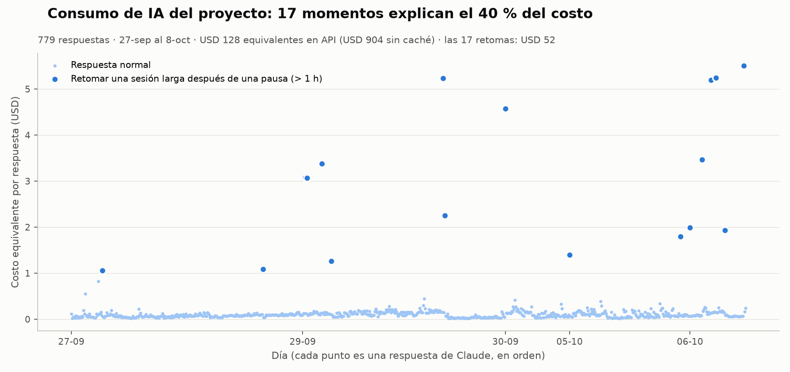

# Consumo de IA del proyecto

Medición de los tokens que usa Claude Code para construir este proyecto, con el objetivo de reducirlos sin perder calidad. Se lee solo la parte de consumo de los registros locales de sesión (`~/.claude/projects`), nunca el texto de las conversaciones.

- `consumo_ia/extraer_consumo.py`: una fila por respuesta del modelo (tokens de entrada, salida, caché escrito y leído, razonamiento, herramientas pedidas) y una por resultado de herramienta (solo su tamaño). Deduplica respuestas copiadas entre carpetas.
- `consumo_ia/analizar_consumo.py`: costo equivalente a precio de lista de la API y causas.

**Costo equivalente**: lo que costarían esos tokens en la API de Anthropic. Claude Opus 5.5: USD 4 entrada, 20 salida, 5 / 8 caché escrito (5 min / 1 h) y 0,20 caché leído, por millón de tokens. El uso con suscripción no se factura por token; la cifra sirve para comparar antes y después.

## Línea base (27-sep al 8-oct-2026)

| Indicador | Valor |
|---|---|
| Respuestas del modelo / sesiones | 779 / 6 |
| Tokens leídos de caché | 212,8 millones |
| Tokens de salida (34,5 % razonamiento) | 0,95 millones |
| Costo equivalente | **USD 128** |
| Costo sin caché | USD 904 (el caché ahorra 86 %) |
| Composición del costo | 52 % escribir caché · 33 % leer caché · 15 % salida |
| Contexto medio por respuesta | 284 000 tokens (máximo 712 000) |

## Hallazgos

1. **Retomar una sesión larga después de una pausa es lo más caro.** El caché dura 1 hora: al volver, se reescribe todo el contexto acumulado. 17 retomas costaron USD 52, el **40 %** del total. Retomar la sesión principal con 690 000 tokens cuesta ~USD 5,5 antes de hacer nada.
2. **Las sesiones largas encarecen cada respuesta.** En la sesión principal, una respuesta del último tramo cuesta 4,7 veces más que una del primero (USD 0,45 vs 0,10), porque cada respuesta relee todo el historial.
3. **Las salidas de herramientas ya son chicas** (Bash: 280 tokens de mediana; solo 6 resultados de más de 5 000 tokens). No es una palanca grande.
4. **La salida del modelo es solo el 15 % del costo.** Recortar texto rinde menos que acortar el contexto.

## Mejoras aplicadas o propuestas

| Palanca | Ahorro esperado | Estado |
|---|---|---|
| `CLAUDE.md` con el resumen del proyecto y reglas (no leer datos pesados, no releer la bitácora) | Permite empezar sesiones nuevas sin re-explorar | ✅ aplicada |
| Una sesión nueva por tarea, en lugar de retomar la sesión gigante después de una pausa | Hasta ~40 % (las retomas) + respuestas más baratas | Propuesta |
| `/compact` cuando la sesión pasa ~200 000 tokens y se va a seguir | Reduce el costo por respuesta | Propuesta |
| Pausas cortas (< 1 h) dentro de una misma tarea | Evita reescribir el caché | Hábito |

Próximo paso: repetir la medición después de 1-2 semanas con estas reglas y comparar costo por respuesta y por tarea.
